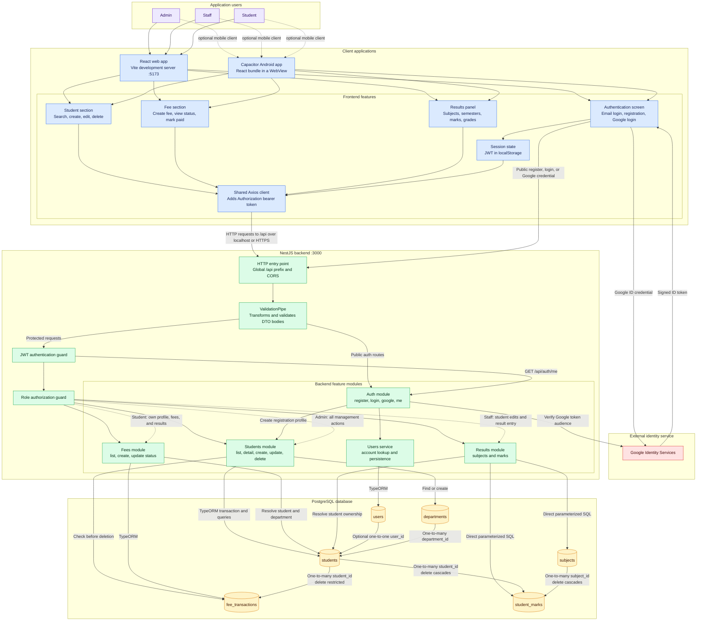

# Secure Student Management Technical Handoff Notes

These notes describe the repository as it exists on 22 November 2026. They explain how the web app, API, database, authentication, and Android wrapper fit together; what is already working; what this laptop still needs; and how to divide future frontend and backend changes between collaborators.

The most important finding is that both codebases compile, but the application cannot run end to end on a fresh laptop. PostgreSQL is absent, and the repository does not contain the base database migrations named in the README. The tracked SQL file creates only the semester results tables after the core student tables already exist.

## Current project status

| Area | Current state | What it means |
| --- | --- | --- |
| Frontend source | Present and builds successfully | The UI can be developed and previewed |
| Backend source | Present and builds successfully | The API compiles, but startup needs a database and complete environment settings |
| Node dependencies | Installed in both folders | `npm ci` does not need to be repeated until the lockfiles change |
| PostgreSQL | Missing and port 5432 is closed | Registration, login, Google login, and all data features cannot complete |
| Base database schema | Missing from the repository | A new database cannot be prepared from the tracked files alone |
| Results schema | Present at `backend/sql/semester-results.sql` | It can be applied only after the core `students` table exists |
| Google web client | Configured locally | The Google prompt can start on `http://localhost:5173` |
| Backend environment | Incomplete | Database variables and required admin variables are missing |
| Android project | Generated and tracked | Building it still needs JDK 21, Android Studio, and Android SDK 36 |
| Tests | 9 of 10 pass | One fee service test has a stale repository mock |
| Git working tree | Has unrelated local changes | Clean and separate changes before handing work to another developer |

## How the system works



The browser runs a React single page application. It sends HTTP requests through one Axios client to the NestJS API. The API validates requests, verifies JWT bearer tokens, applies role checks, and reads or writes PostgreSQL. The Android project packages the same built web application in a Capacitor WebView.

All backend routes receive the global `/api` prefix. A route written as `@Controller('students')` is therefore reached at `/api/students`.

## Repository map

| Path | Purpose |
| --- | --- |
| `frontend/src/main.jsx` | Mounts React and provides Google OAuth and browser routing contexts |
| `frontend/src/App.jsx` | Login, registration, session state, student CRUD, fee UI, and dashboard |
| `frontend/src/ResultsPanel.jsx` | Subjects, semesters, marks, totals, and grades |
| `frontend/src/services/api.js` | Axios base URL and bearer token injection |
| `frontend/src/index.css` | Tailwind import and the small global body rule |
| `frontend/vite.config.js` | React and Tailwind Vite plugins |
| `frontend/capacitor.config.json` | Android application ID, name, and web build directory |
| `frontend/android` | Generated native Android shell, Gradle wrapper, resources, icons, and tests |
| `backend/src/main.ts` | API prefix, CORS, validation, and server startup |
| `backend/src/app.module.ts` | PostgreSQL connection and feature module registration |
| `backend/src/auth` | Registration, password login, Google login, JWT generation, and JWT validation |
| `backend/src/students` | Student records, department linking, ownership rules, search, and pagination |
| `backend/src/fees` | Fee creation, listing, and payment status changes |
| `backend/src/results` | Subject and mark operations implemented with direct PostgreSQL queries |
| `backend/src/users` | User entity and user repository operations |
| `backend/src/departments` | Department entity |
| `backend/sql/semester-results.sql` | `subjects` and `student_marks` tables |
| `backend/src/seed-admin.ts` | Separate admin seed script with important defects described below |
| `postman` and `.postman` | Empty Postman workspace registration; no API collection is included |
| `.claude/skills` | Nine local Claude skills; currently ignored by Git |

The audit covered all project-owned source and configuration files. Lockfiles were checked for their pinned top-level versions and package counts. Generated PNG icons and splash screens, the Gradle wrapper JAR, dependency folders, build output, and cache contents were inventoried rather than interpreted as source code.

## Frontend architecture and behavior

The frontend uses React 18, Vite 5, Tailwind CSS 4, Axios, Google Identity Services through `@react-oauth/google`, and React Router DOM. `BrowserRouter` is mounted, but the app defines no routes. The current screen changes through component state.

`App.jsx` is a 715-line component with most application responsibilities. It stores the session, login and registration fields, students, fees, search text, forms, messages, and refresh state. `ResultsPanel.jsx` is the only extracted feature component.

The session flow is:

1. On page load, the app checks `localStorage` for `accessToken`.
2. If a token exists, it requests `GET /api/auth/me`.
3. A failed initial session check removes the token and shows the login screen.
4. Email login posts email and password to `/api/auth/login`.
5. Registration posts student profile fields to `/api/auth/register` and then returns to login.
6. Google login receives an ID credential in the browser and posts it to `/api/auth/google`.
7. After login, the dashboard loads students and fees, while `ResultsPanel` loads subjects and marks.

The access token is stored in browser local storage. The Axios request interceptor sends it as `Authorization: Bearer <token>`.

The frontend hides controls according to the role returned in the token:

- Admin sees student creation, editing and deletion, fee creation and status actions, and result editing.
- Staff sees student editing and result editing.
- Student receives read-only views of their linked profile, fees, and saved results.

These UI checks improve usability. The backend guards remain responsible for security.

### Frontend API expectations

| Request | Purpose | Expected response |
| --- | --- | --- |
| `GET /api/auth/me` | Restore session | User payload or `{ user }` |
| `POST /api/auth/register` | Create student login and profile | Success response |
| `POST /api/auth/login` | Email and password login | `{ accessToken, user }` |
| `POST /api/auth/google` | Google login | `{ accessToken, user }` |
| `GET /api/students` | List visible students | `{ data, page, limit, total, totalPages }` |
| `POST /api/students` | Create a student | Student object |
| `PATCH /api/students/:id` | Update a student | Student object |
| `DELETE /api/students/:id` | Delete a student | Success message |
| `GET /api/fees` | List visible fees | Fee array |
| `POST /api/fees` | Create a pending fee | Fee object |
| `PATCH /api/fees/:id/status` | Mark a fee paid or pending | Fee object |
| `GET /api/results/subjects` | List semester subjects | Subject array |
| `POST /api/results/subjects` | Create or update a subject by code | Subject object |
| `GET /api/results/marks` | List saved marks | Mark array |
| `POST /api/results/marks` | Save or update marks | Enriched mark object |

### Frontend issues to address

1. `frontend/.env.example` currently points `VITE_API_BASE_URL` to `http://localhost:5173`. That is the Vite frontend, so copying this value causes API requests to go to the wrong server. Local development should use `http://localhost:3000/api`.
2. `App.jsx` has too many responsibilities. Adding another large feature directly will increase state coupling and make handoff harder.
3. Student search sends one API request per keystroke. There is no debounce or cancellation, so an older response can replace a newer result.
4. Students and fees share one error state. A failure in one request can overwrite the other feature's message.
5. The dashboard has no clear initial loading state. Empty data and pending requests look the same.
6. An expired token during normal use is shown as a feature error. Only the initial `/auth/me` failure automatically clears the session.
7. Mark inputs convert an empty string to zero with `Number('')`. Saving incomplete fields can silently record zero marks.
8. Semester totals include only returned mark rows. Unsaved subjects may be excluded from the denominator.
9. Grade cutoffs exist in the frontend and backend. A cutoff change must currently be made in both places.
10. The app loads `/fees` for staff even though the backend denies staff access, so a staff dashboard can show a fee authorization error.
11. There are no frontend tests, test script, lint command, formatter configuration, or type checking. Jest packages are installed but unused.
12. `BrowserRouter` currently adds no routing behavior. Real routes will need frontend route definitions and a server fallback to `index.html`.
13. CSS names the Inter font without loading it. Most machines will use a fallback font.

### Suggested component structure

Create new UI under feature-focused files instead of expanding `App.jsx` further:

```text
frontend/src
├── components
│   ├── AuthScreen.jsx
│   ├── DashboardHeader.jsx
│   ├── StatusMessage.jsx
│   ├── students
│   │   ├── StudentSection.jsx
│   │   └── StudentForm.jsx
│   ├── fees
│   │   └── FeeSection.jsx
│   └── results
│       └── ResultsPanel.jsx
├── services
│   └── api.js
├── App.jsx
└── main.jsx
```

`App.jsx` should own the authenticated user and coordinate feature sections. Each feature should own its loading, error, form, and request state. A new component that needs data should be designed together with its API contract before frontend and backend implementation begin.

## Backend architecture and behavior

The backend uses NestJS 10 with TypeScript, the Express adapter, TypeORM, PostgreSQL, JWT and Passport, bcrypt, Google ID-token verification, and class-validator.

`main.ts` adds the `/api` prefix, allows the local web origin and Capacitor origins, enables DTO validation, and starts on port 3000 by default. Validation removes no declared DTO fields, rejects additional body fields, and transforms supported values.

`app.module.ts` opens a PostgreSQL connection and sets `synchronize: false`. The server therefore never creates the production schema automatically.

### Authentication routes

| Route | Access | Behavior |
| --- | --- | --- |
| `POST /api/auth/register` | Public | Creates a student user, department if needed, and linked student profile in one transaction |
| `POST /api/auth/login` | Public | Verifies bcrypt password and returns a JWT |
| `POST /api/auth/google` | Public | Verifies the Google ID token and finds or creates a student-role user |
| `GET /api/auth/me` | JWT | Returns the JWT payload |

Passwords are hashed with bcrypt cost factor 12. JWTs expire after 15 minutes by default. There is no refresh-token flow.

Public registration always assigns the student role. A Google account with a new email creates a user with a random unusable password and no student profile. That user sees empty student, fee, and result data until an unlinked student record with the same email exists or an admin creates one.

The server also performs admin provisioning during every startup. `AuthService.onModuleInit()` requires `ADMIN_EMAIL` and `ADMIN_PASSWORD`, creates the admin if absent, and overwrites the matching user's password and role on later starts. Missing admin variables stop startup after the database connection succeeds.

### Student routes

| Route | Roles | Behavior |
| --- | --- | --- |
| `GET /api/students` | All authenticated roles | Admin and staff see all; student sees their linked profile |
| `GET /api/students/:id` | All authenticated roles | Student can read only their own linked profile |
| `POST /api/students` | Admin | Creates a record and links a matching unlinked user |
| `PATCH /api/students/:id` | Admin and staff | Updates a record; staff email changes are removed |
| `DELETE /api/students/:id` | Admin | Deletes only when no fee records exist |

The list supports `page`, `limit`, `search`, and `cgpa_min`. It returns pagination metadata. Department names are normalized and departments are created when needed.

Important data behavior:

- A student's first list request can write to the database by linking an unlinked profile with the same email.
- Updating a student email does not update the linked user email, so profile identity and login identity can diverge.
- Deleting a student leaves the user account able to log in without a profile.
- Fee records block student deletion. Result records cascade when a student is deleted.
- Query parameters are handled as `any`; invalid filters can be silently ignored.

### Fee routes

| Route | Roles | Behavior |
| --- | --- | --- |
| `GET /api/fees` | Admin and student | Admin sees all; student sees linked fees |
| `POST /api/fees` | Admin | Creates a pending fee |
| `PATCH /api/fees/:id/status` | Admin | Changes status between `PENDING` and `PAID` |

Fee amounts use PostgreSQL numeric precision of two decimal places. Marking a fee paid records the current timestamp. Repeating that action replaces the timestamp. Returning it to pending clears the timestamp. The API has no fee deletion route, which preserves payment history.

### Result routes

| Route | Roles | Behavior |
| --- | --- | --- |
| `GET /api/results/subjects` | All authenticated roles | Lists all subjects or one semester |
| `POST /api/results/subjects` | Admin and staff | Upserts a subject by code |
| `GET /api/results/marks` | All authenticated roles | Students see their rows; staff and admin may filter by student |
| `POST /api/results/marks` | Admin and staff | Upserts one student's marks for one subject |

Results use direct SQL instead of TypeORM entities. Marks must be nonnegative integers and cannot exceed each subject's configured maximum through the API. Grades are calculated from the combined percentage:

| Percentage | Grade |
| --- | --- |
| 90 and above | O |
| 80 to below 90 | A+ |
| 70 to below 80 | A |
| 60 to below 70 | B+ |
| 50 to below 60 | B |
| 40 to below 50 | C |
| Below 40 | Fail |

Only saved mark rows are returned. The backend does not create blank rows for subjects whose marks have not been entered.

### Backend issues to address

1. The repository has no clean-install migration for `users`, `departments`, `students`, or `fee_transactions`.
2. Startup requires `ADMIN_EMAIL` and `ADMIN_PASSWORD`, while the README describes admin creation as a separate optional command.
3. `seed-admin.ts` does not load `.env`, uses a different default database, enables schema synchronization, registers an incomplete entity list, and behaves differently from startup provisioning.
4. Admin student email changes do not synchronize the linked user email.
5. Google users do not receive a student profile.
6. There is no supported API to create or promote a staff account.
7. Login has no throttling or rate limiting.
8. `GET /auth/me` returns token data without confirming the user still exists or still has the same role.
9. Roles remain in issued tokens until token expiry, even after the database role changes.
10. Duplicate or concurrent email and department operations can become unhandled database errors.
11. Creating a subject with a new code but a duplicate semester and name can become an unhandled database error.
12. The database prevents negative marks but does not enforce each subject's maximum. Direct database writes can exceed it.
13. Fee and result lists have no pagination.
14. `passport-google-oauth20` is installed but unused; the implementation uses `google-auth-library` directly.

## Database design

The TypeORM model expects these core tables:

```text
users
  id, email, password_hash, role, created_at
  one optional student profile

departments
  id, unique name
  many students

students
  id, name, unique email, age, cgpa
  optional unique user_id
  required department_id

fee_transactions
  id, student_id, description, amount, due_date
  status, paid_at, created_at

subjects
  id, semester, name, unique code
  internal and semester maximum marks

student_marks
  id, student_id, subject_id
  internal_mark, semester_mark, timestamps
  unique student and subject pair
```

The tracked SQL creates only `subjects` and `student_marks`. It references `students(id)`, so it cannot run first.

The README names these missing files:

- `backend/database/migrations/001_departments_one_to_many.sql`
- `backend/database/migrations/002_fee_transactions.sql`
- `backend/.env.example`

The README also assumes `users` and `students` already exist. It is therefore an upgrade note for an older database rather than a complete installation guide. No database backup, dump, SQLite file, or PostgreSQL data directory exists in this repo.

The correct long-term fix is a numbered migration history that creates the complete schema from an empty PostgreSQL database and can upgrade an older database safely. Keep `synchronize: false` for normal use.

## Environment configuration

The backend needs a private `backend/.env` containing these names:

```dotenv
DB_HOST=localhost
DB_PORT=5432
DB_USERNAME=postgres
DB_PASSWORD=replace_with_local_database_password
DB_DATABASE=secure_student_db

JWT_SECRET=replace_with_a_long_random_value
JWT_EXPIRES_IN=15m

GOOGLE_CLIENT_ID=replace_with_google_web_client_id

ADMIN_EMAIL=replace_with_admin_email
ADMIN_PASSWORD=replace_with_a_strong_admin_password

FRONTEND_ORIGIN=http://localhost:5173
PORT=3000
```

The frontend local environment should contain:

```dotenv
VITE_API_BASE_URL=http://localhost:3000/api
VITE_GOOGLE_CLIENT_ID=replace_with_google_web_client_id
```

The Google client ID is an identifier used by browser code. The Google client secret, database password, JWT secret, and admin password must never enter a frontend `VITE_` variable.

Actual `.env` files are ignored by Git. Commit safe `.env.example` templates containing placeholders so another laptop knows which variables are required.

## Technologies required

| Technology | Why it is needed | Current laptop |
| --- | --- | --- |
| Node.js | Runs Vite, Nest, tests, and build tools | Installed, version 26.13.0 |
| npm | Installs locked JavaScript packages and runs scripts | Installed, version 11.20.0 |
| Git | Branches and transfers work between collaborators | Installed, version 2.56.0 |
| VS Code or another editor | Source editing and terminals | VS Code installed |
| PostgreSQL server | Stores all application data | Missing |
| PostgreSQL CLI tools | Create, migrate, inspect, back up, and restore the database | Missing |
| Google Cloud OAuth web client | Enables Google sign-in | Created and configured for local web use |
| JDK 21 | Compiles the Capacitor Android project | Missing |
| Android Studio and SDK 36 | Builds, installs, and debugs the Android app | Missing |
| ADB | Communicates with Android devices and emulators | Missing |

Docker, Podman, MongoDB, MySQL, a global Gradle installation, and Firebase are not required for the current web application. Docker or Podman could later provide PostgreSQL reproducibly. The Android project includes its own Gradle wrapper. Firebase becomes relevant only if features such as push notifications are added.

## Android wrapper

Capacitor packages `frontend/dist` as application `com.securestudentmanagement.app`. It targets Android SDK 36, has minimum SDK 24, uses Gradle 8.14.3, and compiles Java 21. The manifest currently requests only Internet permission.

An Android phone interprets `localhost` as the phone itself. The packaged app therefore needs a deployed HTTPS backend or a development API address the device can reach. The production frontend build should use `frontend/.env.production` with that URL.

The generated Android instrumentation test expects `com.getcapacitor.app`, while the application ID is `com.securestudentmanagement.app`. That placeholder test will fail until corrected. The repository also lacks release signing configuration. `google-services.json` is absent, which affects Firebase-style Google services and is separate from the current web Google ID-token flow.

Google sign-in inside the Capacitor WebView still needs device validation and may need a mobile-specific sign-in integration.

## Verification completed

| Check | Result |
| --- | --- |
| Frontend dependency tree | Complete |
| Backend dependency tree | Complete |
| Frontend production build | Passed |
| Backend TypeScript build | Passed |
| Backend Jest suites | Three passed, one failed |
| Backend Jest tests | Nine passed, one failed |
| PostgreSQL connection | Failed because no server is listening on port 5432 |
| Frontend server | Not running during the audit |
| Backend server | Cannot reach runtime-ready state without PostgreSQL and missing environment variables |
| Android build | Not run because JDK and Android SDK are absent |

The one failing Jest test is `fees.service.spec.ts`. Its student repository mock provides `findOneBy`, while `FeesService.create()` now calls `findOne()` with department relations. The service compiles; the test needs to match the current repository call.

## Priority repair plan

### Priority zero: make a fresh installation possible

1. Install PostgreSQL and its command-line tools.
2. Create a full base migration for users, departments, students, and fee transactions.
3. Make the results SQL part of the same ordered migration history.
4. Add a correct `backend/.env.example` and correct `frontend/.env.example`.
5. Choose one admin provisioning method. Repair either startup provisioning or the seed script and remove the conflicting path.
6. Create the database, run migrations, start the backend, and verify registration, password login, Google login, and role access.

### Priority one: stabilize current behavior

1. Repair the fee service unit test.
2. Stop staff sessions from requesting an unauthorized fee list, or explicitly grant staff fee access if that is the product rule.
3. Define how Google users receive or link a student profile.
4. Keep `User.email` and `Student.email` consistent in one transaction.
5. Add database error handling for duplicate emails, departments, and subjects.
6. Add frontend loading states, request cancellation, and global 401 handling.
7. Add backend tests for roles, ownership, login, Google login, results, and migrations.

### Priority two: prepare new features and collaboration

1. Extract frontend feature components from `App.jsx`.
2. Add an OpenAPI document or a Postman collection with real endpoint examples.
3. Add a root setup command or documented sequence for installing and running both applications.
4. Add CI that runs both builds and backend tests for every branch.
5. Add deployment configuration before producing an Android build.

## Adding a new component

Before coding, write a short contract for the component:

```text
Feature name
User roles allowed
What the user can see and do
Frontend component and parent
API method and /api path
Query parameters
Request JSON
Success response JSON
Validation rules
Expected 400, 401, 403, 404, and 409 errors
Database tables or relations changed
Refresh or cache behavior after success
```

If the component is display-only and uses data already loaded by `App.jsx`, it can begin as a frontend task. If it adds or changes stored data, define the API and migration first, then implement frontend and backend against the same examples.

## Frontend and backend handoff to a friend

The cleanest collaboration flow is:

1. Agree on the contract above and save it in an issue or tracked Markdown file.
2. Create one frontend branch and one backend branch from the same known commit.
3. Let the frontend use example JSON or a small mock while the backend implements the real endpoint.
4. Keep database migrations with the backend change that needs them.
5. Commit safe environment templates and document every new variable.
6. Add one happy-path and one permission or validation test for the endpoint.
7. Run `npm ci`, builds, tests, and a real browser-to-database check before merging.
8. Merge the backend contract first when the frontend depends on it, then connect and verify the frontend.

For every backend handoff, give your friend the method, full `/api/...` path, allowed roles, exact request and response examples, validation, database change, and error behavior. A component screenshot alone does not specify enough for backend implementation.

## Git state and sharing

The active branch is `Sub-Branch-X1`. The remote is `studywithbutter-pvt/Secure-student-management-V2.git`.

The current tracked changes are:

- `.gitignore` now ignores `.claude`.
- `backend/src/users/user.entity.ts` has a newline-only change.
- `frontend/.env.example` has the incorrect localhost port change.

The real `backend/.env` and `frontend/.env.local` are ignored, which is correct. `node_modules`, build outputs, and TypeScript build metadata are also ignored.

All nine Claude skills are currently ignored with `.claude/settings.json`. If the skills should travel to another laptop, add targeted Git exceptions for `.claude/skills/**` and keep `.claude/settings.json` ignored because it contains machine-specific routing configuration.

Use `npm ci` after cloning or pulling because both lockfiles are tracked. Keep frontend, backend, migration, and documentation changes in focused commits so your friend can review or cherry-pick them without taking unrelated work.

## Commands after the database setup is repaired

Backend terminal:

```powershell
cd "D:\Secure Student Management\Secure-student-management-\backend"
npm.cmd ci
npm.cmd run start:dev
```

Frontend terminal:

```powershell
cd "D:\Secure Student Management\Secure-student-management-\frontend"
npm.cmd ci
npm.cmd run dev
```

Verification:

```powershell
cd "D:\Secure Student Management\Secure-student-management-\backend"
npm.cmd run build
npm.cmd test -- --runInBand

cd "D:\Secure Student Management\Secure-student-management-\frontend"
npm.cmd run build
```

The browser URL is `http://localhost:5173`. The API origin is `http://localhost:3000`, and application endpoints begin with `http://localhost:3000/api`.
